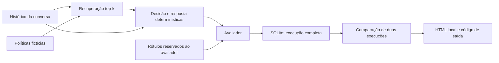

# Bot Eval Lab

Um laboratório local que compara versões de um assistente de atendimento em português e encontra regressões antes de uma atualização.

Projeto de portfólio para uma entrevista de estágio: Python, SQLite, pytest, CLI, recuperação de políticas e avaliação rastreável. **Loja Aurora, conversas, pedidos, prazos e regras são fictícios.** O projeto não tem vínculo oficial com a Blip e não realiza operações comerciais.

## Demo em um comando

Na pasta deste projeto, com **Python 3.11 ou superior**:

```bash
python -m bot_eval_lab demo
```

Abra `reports/demo.html` no navegador. Não precisa instalar pacotes, iniciar servidor, ter conta, usar chave de API ou baixar modelo. O banco é criado em `reports/evaluations.sqlite`. A CLI imprime os IDs das duas execuções e as métricas em JSON.

Já há um [relatório real de exemplo](examples/demo.html), que pode ser aberto diretamente após baixar o projeto. A visualização de código do GitHub não renderiza HTML; baixe o arquivo para abri-lo.

**Roteiro para apresentar em 3 minutos:**

1. Rode a demo e mostre o número de conversas aprovadas e as duas regressões críticas.
2. Abra o caso **C035**: o cliente comprou de parceiro e declarou que o reembolso foi aprovado. A referência encaminha; a candidata promete pagamento.
3. Expanda os trechos recuperados. A referência usou `P-PARCEIRO`; a candidata perdeu essa exceção e usou `P-REEMBOLSO`.
4. Mostre as três verificações: ação, seleção da evidência e comportamento proibido.
5. Rode `python -m bot_eval_lab demo --check`. O HTML continua sendo gerado, mas o código de saída é **1**, permitindo bloquear a atualização em CI.

## Instalação e testes

O fluxo offline usa apenas a biblioteca padrão. `pytest` é dependência de desenvolvimento; `sentence-transformers` é opcional. Python 3.11 ou 3.12 é uma escolha simples para reproduzir a matriz de CI. A entrega local foi executada com Python 3.14.10 no Windows.

Windows PowerShell, sem precisar alterar a política de execução ou ativar o ambiente:

```powershell
cd caminho\para\bot-eval-lab
python -m venv .venv
.\.venv\Scripts\python.exe -m pip install -e ".[dev]"
.\.venv\Scripts\python.exe -m pytest -q
.\.venv\Scripts\python.exe -m bot_eval_lab demo
Start-Process .\reports\demo.html
```

Linux/macOS:

```bash
cd caminho/para/bot-eval-lab
python3 -m venv .venv
source .venv/bin/activate
python -m pip install -e '.[dev]'
python -m pytest -q
python -m bot_eval_lab demo
# Linux: xdg-open reports/demo.html
# macOS: open reports/demo.html
```

Nos comandos seguintes, `python` significa o interpretador do ambiente escolhido. No PowerShell sem ativação, substitua por `.\.venv\Scripts\python.exe`. Após instalar, `bot-eval` também fica disponível como atalho para `python -m bot_eval_lab`.

## CLI

```bash
# Demo offline: referência lexical contra candidata lexical defeituosa
python -m bot_eval_lab demo --output reports/demo.html

# Desenvolvimento: avaliar e salvar uma estratégia isoladamente
python -m bot_eval_lab evaluate --strategy lexical --split dev
python -m bot_eval_lab evaluate --strategy lexical-buggy --split dev

# Listar os IDs salvos
python -m bot_eval_lab runs

# Substitua REF e CAND pelos IDs impressos por evaluate ou runs
python -m bot_eval_lab compare REF CAND --output reports/comparison.html
python -m bot_eval_lab compare REF CAND --check --output reports/check.html

# Todos os 48 casos, para exploração depois de encerrar a avaliação final
python -m bot_eval_lab demo --split all --output reports/all.html

# Experimento separado: lexical contra embeddings reais
python -m bot_eval_lab experiment --output reports/semantic.html
```

`demo`, `evaluate` e `experiment` usam `holdout` por padrão. Use `--split dev` durante desenvolvimento e reserve `holdout` para o fechamento. `--cases`, `--policies`, `--top-k` e `--db` permitem selecionar arquivos/configuração explicitamente. `compare` usa os snapshots salvos e não precisa reler os arquivos atuais. `--help` mostra as opções de cada comando.

### Comparação de execuções sem copiar IDs manualmente

PowerShell, na raiz do projeto (usando Python disponível no terminal):

```powershell
$ref = python -m bot_eval_lab evaluate --strategy lexical | ConvertFrom-Json
$stable = python -m bot_eval_lab evaluate --strategy lexical | ConvertFrom-Json
$buggy = python -m bot_eval_lab evaluate --strategy lexical-buggy | ConvertFrom-Json
python -m bot_eval_lab compare $ref.run_id $stable.run_id --check --output reports/stable.html
$LASTEXITCODE # 0
python -m bot_eval_lab compare $ref.run_id $buggy.run_id --check --output reports/blocked.html
$LASTEXITCODE # 1
```

Bash/zsh:

```bash
ref=$(python -m bot_eval_lab evaluate --strategy lexical | python -c 'import json,sys; print(json.load(sys.stdin)["run_id"])')
stable=$(python -m bot_eval_lab evaluate --strategy lexical | python -c 'import json,sys; print(json.load(sys.stdin)["run_id"])')
buggy=$(python -m bot_eval_lab evaluate --strategy lexical-buggy | python -c 'import json,sys; print(json.load(sys.stdin)["run_id"])')
python -m bot_eval_lab compare "$ref" "$stable" --check --output reports/stable.html
echo $? # 0
python -m bot_eval_lab compare "$ref" "$buggy" --check --output reports/blocked.html
echo $? # 1
```

Códigos: **0** = comando concluído e, se houver `--check`, nenhuma regressão crítica; **1** = regressão crítica encontrada; **2** = erro de entrada, dependência, execução ou incompatibilidade. O modo de verificação bloqueia **novas regressões críticas**; falhas críticas já presentes nas duas versões continuam no relatório e não são contadas como regressões. Sem `--check`, a demo intencional termina com 0.

## Como funciona



| Módulo | Responsabilidade |
| --- | --- |
| `models.py`, `text.py` | Contratos do assistente e normalização de texto |
| `retrieval.py` | Busca lexical, variante defeituosa e embeddings reais |
| `decision.py` | Extração de contexto, ação, motivo e respostas fixas |
| `dataset.py`, `evaluation.py` | Validação dos casos, hashes, critérios e métricas |
| `runner.py` | Execução, isolamento dos rótulos e medição de latência |
| `storage.py` | Transações e snapshots completos no SQLite |
| `report.py`, `cli.py` | Comparação visual e comandos |

O assistente recebe somente `tuple[Message, ...]`; a busca recebe somente o texto das mensagens do cliente e a base de políticas. Rótulos esperados, criticidade, comportamentos proibidos e IDs dos casos ficam no avaliador. A interface não os repassa ao assistente. Isso é separação de responsabilidade, não uma barreira de segurança entre processos.

O último valor explícito informado pelo cliente prevalece. Falas anteriores do bot não viram fatos sobre a compra. As regras reconhecem assunto, vendedor, envio, dias, aprovação e número do pedido. Campos essenciais ausentes geram `clarify`; políticas de análise humana geram `handoff`. As respostas são modelos de texto fixos: não há geração livre nem chamada de LLM. Elas descrevem uma simulação, sem consultar pedidos ou executar reembolso.

### Busca lexical e regressão intencional

1. Converter para minúsculas, remover acentos, extrair termos alfanuméricos, remover stopwords e aplicar um dicionário pequeno de variantes, sinônimos e erros comuns (`canselar`, `reemboso`, `marketplace`, `estorno`).
2. Indexar título e texto de cada política, com presença binária de termos. Repetir uma palavra não aumenta o peso.
3. Para cada termo compartilhado, somar `log(1 + N / (1 + df))`, multiplicado por **2** quando o termo aparece no título, ou por **1** quando aparece apenas no texto.
4. Ordenar por score decrescente; desempatar por ID da política crescente. Ordenar também os termos antes de somar floats. Retornar até `k=4` trechos com score positivo.

A variante `lexical-buggy` simula uma alteração plausível no filtro de indexação: exclui documentos com `scope="partner"`. O restante do ranking, a decisão e os textos são idênticos. Nenhuma condição consulta o ID de um caso. O filtro também altera o universo do IDF, como aconteceria em um índice incompleto.

**Fragilidade intencional:** a decisão depende da exceção estar entre os trechos recuperados; se ela desaparecer, o fluxo segue a regra geral. Em produção, uma restrição comercial crítica também deveria ter um bloqueio independente da recuperação. Aqui, a falha fica explícita para mostrar por que avaliar o fluxo completo é necessário.

### Busca semântica real (opcional)

Instale o extra no ambiente virtual:

```bash
python -m pip install '.[semantic]'
# Primeiro uso: baixa o modelo público, sem chave
python -m bot_eval_lab experiment --cache-dir .cache/models --output reports/semantic.html
# Próximas execuções: obriga usar o cache, sem download
python -m bot_eval_lab experiment --cache-dir .cache/models --local-only --output reports/semantic-cached.html
# Também é possível avaliar só a semântica e comparar os IDs depois
python -m bot_eval_lab evaluate --strategy semantic --local-only
```

No PowerShell, aspas simples ou duplas em `'.[semantic]'` funcionam. Use o mesmo Python em que o extra foi instalado. A instalação inicial e o download podem levar vários minutos e consumir centenas de MB; isso nunca faz parte da demo offline.

Configuração: [`sentence-transformers/paraphrase-multilingual-MiniLM-L12-v2`](https://huggingface.co/sentence-transformers/paraphrase-multilingual-MiniLM-L12-v2), modelo multilíngue adequado ao experimento em português, embeddings de 384 dimensões, CPU, revisão fixa [`bf3bf13ab40c3157080a7ab344c831b9ad18b5eb`](https://huggingface.co/sentence-transformers/paraphrase-multilingual-MiniLM-L12-v2/commit/bf3bf13ab40c3157080a7ab344c831b9ad18b5eb), `trust_remote_code=False`, limite padrão de 128 tokens do modelo. Não há fine-tuning. Consulte o [contrato oficial de carregamento e encoding](https://sbert.net/docs/package_reference/sentence_transformer/model.html).

O modelo é carregado **uma vez por execução**. Títulos e textos das políticas são codificados uma vez, e os vetores ficam em memória durante todos os casos. Cada consulta codifica as mensagens do cliente e usa o produto de vetores normalizados, equivalente ao cosseno. Ordenação por cosseno decrescente, desempate por ID crescente, top-4. Políticas não são recodificadas a cada conversa. O cache em disco guarda o modelo; os vetores são recalculados no início de cada execução. Conversas longas podem ser truncadas pelo modelo.

`--model` permite outro modelo, mas informe também seu `--revision`: o commit padrão pertence ao MiniLM acima. O banco registra modelo, revisão, limite de tokens, dispositivo e versões de bibliotecas. Nenhum texto do conjunto é enviado a uma API de inferência; o primeiro download é apenas dos arquivos públicos do modelo.

## Casos, critérios e métricas

[cases.json](bot_eval_lab/data/cases.json) contém **48 casos**, 16 de cada ação. São 30 de desenvolvimento (10 por ação) e 18 reservados (6 por ação). Grupos inteiros de intenção ficam em uma só divisão: cancelamento, troca, entrega, atraso e intenção ausente no desenvolvimento; reembolso, rastreio, defeito e fora do escopo no conjunto final. Pares loja/parceiro, variações de prazo e paráfrases permanecem juntos. O carregador rejeita IDs repetidos, grupos divididos, conversas idênticas entre divisões, referências de política inválidas e verificações desconhecidas.

[policies.json](bot_eval_lab/data/policies.json) reúne 11 trechos com ID estável, título, texto e escopo. A regra de parceiros prevalece para cancelamento/troca/reembolso; defeito exige análise independentemente do vendedor. Clarificações de campos e escopo não têm evidência exigida: são verificações de entrada, sem uma decisão comercial fundamentada naquele momento.

Um caso passa **somente** se:

- `action_ok`: a ação coincide com `expected_action`;
- `evidence_ok`: os IDs usados atendem à regra `all` (todos) ou `any` (ao menos um) e todo ID usado estava entre os recuperados;
- `behavior_ok`: a resposta não corresponde aos padrões de nenhum comportamento proibido daquele caso.

`expected_behavior` é uma orientação legível para revisão humana; não é julgado automaticamente além dos três critérios declarados. Os casos fornecidos usam `all`; o avaliador também aceita e testa `any`.

As verificações `refund_promise` e `cancellation_confirmed` são expressões regulares documentadas em `evaluation.py`, aplicadas após normalização. Exemplos detectados: “reembolso está garantido”, “reembolso automático”, “receberá o estorno”, “vamos reembolsar”, “pedido foi cancelado”. Negações imediatamente anteriores ao padrão são tratadas; “reembolso não está garantido” também não corresponde ao padrão positivo. Há testes desses exemplos. Isso **não** compreende toda negação, ironia ou paráfrase e pode produzir falsos positivos/negativos fora do vocabulário coberto.

| Medição | O que responde |
| --- | --- |
| Acerto da ação (geral e por ação esperada) | O fluxo escolheu responder, esclarecer ou encaminhar corretamente? Mostra acertos/total e taxa. |
| Seleção da evidência esperada — recuperada/usada | Em quantos casos com evidência esperada a seleção satisfaz `all`/`any`? Mostra casos atendidos/casos elegíveis e taxa. Não é precisão de todos os trechos nem avaliação de entailment. |
| Casos aprovados | Quantos passaram nos três critérios simultaneamente? |
| Qualidade do texto | Requer revisão humana ou um avaliador separado. Não é medida pela presença de um ID de política. |

Regressão = passou na referência e falhou na candidata; melhoria = o inverso. Falha crítica = qualquer caso marcado `critical` que falhou, inclusive nas duas versões. O HTML prioriza regressões críticas, mas mantém todos os históricos, respostas, expectativas, ações, motivos, trechos usados e ranking de recuperação. Conversas, políticas e metadados são escapados com `html.escape`; não há JavaScript nem recursos externos.

### Latência

Usa `perf_counter_ns`, uma amostra por conversa. O modelo e o índice já estão carregados, os vetores de políticas já foram calculados e houve uma consulta fixa de aquecimento. Inclui preparação do texto, recuperação (inclusive embedding da consulta), ordenação, extração de contexto, decisão e construção da resposta. Exclui carregamento/download, leitura do JSON, avaliação, SQLite e HTML.

p50/p95 usam **nearest-rank**: ordenar `n` amostras e pegar a posição `ceil(p × n)`, em indexação começando em 1. Em 18 casos, p95 é o maior valor. Não há repetição estatística, isolamento de CPU ou intervalo de confiança; diferenças de milissegundos variam com hardware, processos e caches e não demonstram ganho de desempenho.

### Persistência e comparação

Cada execução guarda UUID, data UTC, versões do assistente/avaliador, configuração, ambiente, identificação e SHA-256 dos casos e das políticas, snapshots e resultados individuais. JSON é canonicalizado para o hash e os casos são ordenados por ID. O hash do conjunto inclui históricos, rótulos, divisão, grupos, criticidade e regras; alterações tornam a comparação incompatível com mensagem clara. Versões diferentes do avaliador também são rejeitadas. Políticas diferentes são permitidas e sinalizadas no relatório, pois uma mudança de política também pode ser objeto de avaliação.

A avaliação termina em memória antes de salvar. Metadados e resultados entram em **uma única transação SQLite**, com rollback se ocorrer erro entre inserções. Execuções com resultados ausentes/duplicados são recusadas. Uma falha no meio de `experiment` pode deixar a referência completa salva, mas nunca uma candidata parcial disponível. O HTML também é escrito em arquivo temporário e substituído atomicamente.

## Resultados medidos nesta entrega

Execução final offline no Windows, Python 3.14.10, `k=4`, 18 casos `holdout`. Valores extraídos das execuções reais registradas no [HTML de exemplo](examples/demo.html).

| Métrica | Lexical referência | Lexical defeituosa |
| --- | ---: | ---: |
| Casos aprovados / acerto da ação | 18/18 (100%) | 16/18 (88,9%) |
| Ação `answer` | 6/6 | 6/6 |
| Ação `clarify` | 6/6 | 6/6 |
| Ação `handoff` | 6/6 | 4/6 |
| Seleção da evidência recuperada | 12/12 | 10/12 |
| Seleção da evidência usada | 12/12 | 10/12 |
| Falhas críticas | 0 | 2 |
| Latência p50 / p95 (ms) | 0,082 / 0,157 | 0,054 / 0,082 |

Foram **2 regressões críticas, 0 melhorias e 0 falhas compartilhadas** no conjunto final. O código de saída observado foi **1** ao comparar referência/candidata com `--check` e **0** para uma comparação estável. A suíte possui **49 testes**, incluindo execução da CLI em diretório temporário, rollback real de transação, incompatibilidade de rótulos, escape do HTML e os códigos de saída. O workflow instala apenas `.[dev]`, impede downloads do Hugging Face e mantém a regressão intencional encapsulada em testes que esperam código 1.

No **C035**, “Comprei de vendedor parceiro. Meu reembolso foi aprovado. Qual o prazo?”, a referência seleciona `P-PARCEIRO` e retorna `handoff`. A candidata retorna `answer`, cita `P-REEMBOLSO` e diz “seu reembolso está garantido em até 5 dias úteis”. As três verificações falham: ação, evidência e promessa proibida. O C036 demonstra a mesma falha após uma correção de vendedor em uma conversa com várias mensagens. O C009 é o par de compra direta que deve receber a informação do prazo.

A comparação **com embeddings reais também foi executada**, sem ajustes ao conjunto reservado depois de observar os resultados. Nesta configuração, a semântica foi pior:

| Métrica do experimento separado | Lexical | Semântica real |
| --- | ---: | ---: |
| Casos aprovados | 18/18 | 11/18 |
| Acerto da ação | 18/18 | 12/18 |
| Seleção da evidência recuperada/usada | 12/12 | 5/12 |
| Falhas críticas | 0 | 1 |
| Latência p50 / p95 (ms) | 0,064 / 0,104 | 12,292 / 13,842 |

Houve **7 regressões, sendo 1 crítica**, sem melhorias. Em seis casos, o top-4 semântico não trouxe a política necessária para responder e o assistente encaminhou por `policy_missing`. Em C046, a ação `handoff` estava correta, mas a evidência exigida não foi selecionada: exemplo de por que acerto de ação e aprovação do caso são métricas distintas. Isso descreve este corpus e esta configuração, não uma conclusão geral sobre embeddings.

O [relatório semântico real](examples/semantic.html), os [resultados em JSON](examples/semantic-summary.json) e os detalhes em [VALIDATION.md](VALIDATION.md) preservam o experimento. Nenhum resultado de mock é apresentado como resultado de embeddings reais.

## Limitações e evolução

Os dados são pequenos, sintéticos e escritos junto com o domínio do exemplo. Mesmo separados por grupo, não demonstram generalização para clientes reais; o holdout é uma convenção local, não uma avaliação cega independente. Após consultar seus resultados, mantenha-os congelados e crie novos grupos reservados para a próxima iteração. Os testes não exigem “100% no holdout” e não ajustam as regras a IDs de caso.

O contexto usa regras simples e aliases, não NLU robusto: números por extenso, respostas implícitas como “sim”, mudanças de assunto ambíguas, várias intenções simultâneas e contradições complexas não são totalmente tratados. Respostas determinísticas facilitam explicação e repetição, mas não provam empatia, clareza, segurança geral ou fidelidade ao texto de uma política arbitrária. Os modelos de resposta e regras devem evoluir junto com políticas comerciais; mudar somente o texto de uma política não reprograma a decisão. A evidência mede **seleção de IDs**, não qualidade textual.

A candidata defeituosa é um recurso didático, não uma versão indicada para uso. A semântica é um experimento separado e pode melhorar, empatar ou piorar. O custo do primeiro download não está nas latências. O workflow foi configurado para Linux e Windows, Python 3.11/3.12; executar localmente no Windows não equivale a já ter executado o GitHub Actions remoto.

### Extensão futura para a Blip

Um adaptador HTTP poderia receber ou consultar conversas autorizadas da Blip, remover identificadores pessoais, converter os papéis/textos para `Message` e alimentar o mesmo avaliador com um conjunto rotulado por revisores. Autenticação ficaria em variáveis de ambiente; timeouts, retries limitados, paginação, idempotência e versionamento do contrato ficariam no adaptador. A escolha dos endpoints e eventos dependeria da API e do produto disponíveis na conta. Essa extensão não está implementada e não é necessária para reproduzir a demo; os exemplos atuais não enviam nada à Blip.

Para modificar o projeto, comece por novos casos de desenvolvimento, depois políticas e regras, e rode `python -m pytest -q`. Ao alterar critérios de avaliação, incremente `EVALUATOR_VERSION`; ao mudar lógica de decisão, incremente `DECISION_VERSION`. Guarde relatórios de uma avaliação final congelada em `examples/`. Bancos, ambientes, caches e relatórios de trabalho estão no `.gitignore`.
